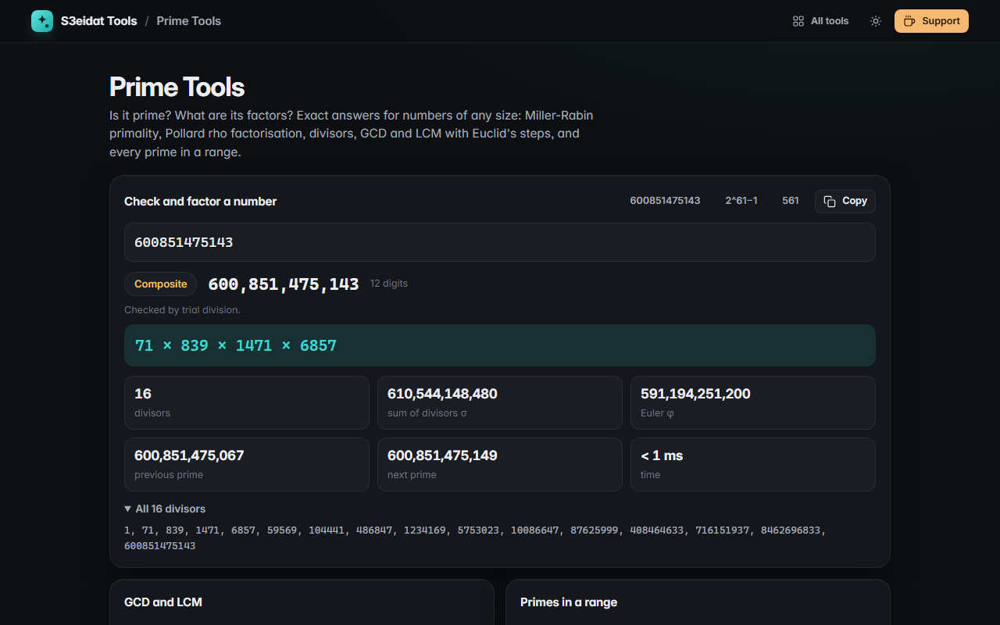

# Prime Tools

> Primality, factorisation, divisors, GCD and LCM, and primes in a range, for numbers of any size. Free, private, and it runs entirely in your browser.

### ▶ [Open Prime Tools](https://s3eidat.github.io/prime-tools/)



## Features

- **Is it prime?** Trial division for small numbers, **deterministic Miller-Rabin** (12 prime bases) for every number below 2⁶⁴, and Miller-Rabin with extra random bases above that, clearly labelled **probable prime**
- **Factorisation** by trial division up to 100,000 and **Pollard's rho** (Brent's variant) for the rest; a part that is too hard to split in the time allowed is shown, not hidden
- **Divisors**: count, sum (σ), Euler's φ, the full list, perfect-number check
- **Next and previous prime**
- **GCD and LCM** of up to 50 numbers with **Euclid's algorithm** written out step by step
- **Primes in a range** with a segmented sieve (up to 10,000,000 numbers at a time, below 10¹⁵); copy or download as `.txt`
- Numbers can be typed as expressions: `2^61-1`, `1000003*1000033`, `(2+3)^2`, `30!`

Checked by a built-in self-test: known primes (2⁶¹−1, the largest prime below 2⁶⁴), Carmichael numbers (561, 1105, 1729 …), strong pseudoprimes, and Pollard rho on 600851475143 = 71 × 839 × 1471 × 6857.

## Privacy

Nothing leaves your device. There is no server, no account, no analytics.
The page ships with a strict Content-Security-Policy (`connect-src 'self'`), so the browser
itself blocks any attempt to send data anywhere.

## Run it yourself

It's plain HTML, CSS and JavaScript with no build step:

```bash
git clone https://github.com/s3eidat/prime-tools
cd prime-tools
python -m http.server 8000
```

Then open http://localhost:8000.

## Support

If this saved you time, **[buy me a coffee ☕](https://s3eidat.github.io/coffee/)**. It keeps every tool free.

---

Part of **[S3eidat Tools](https://s3eidat.github.io/)**: 100+ free, private tools that run in your browser. MIT licensed.
